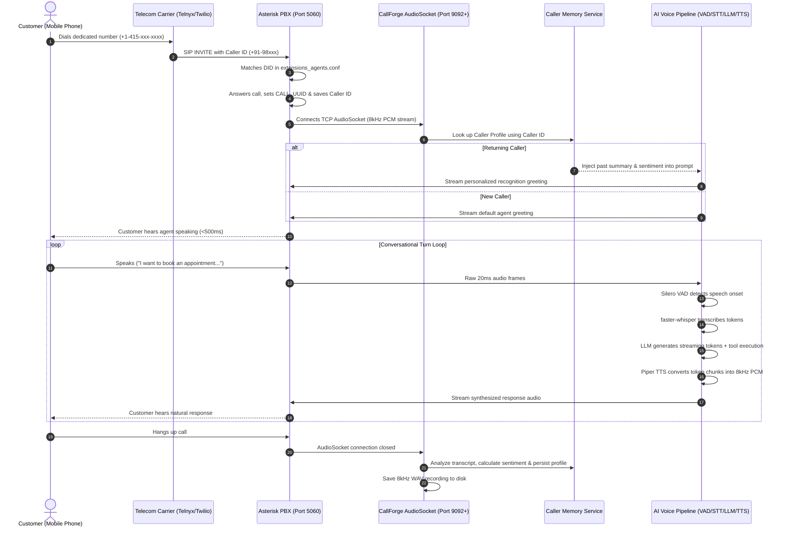
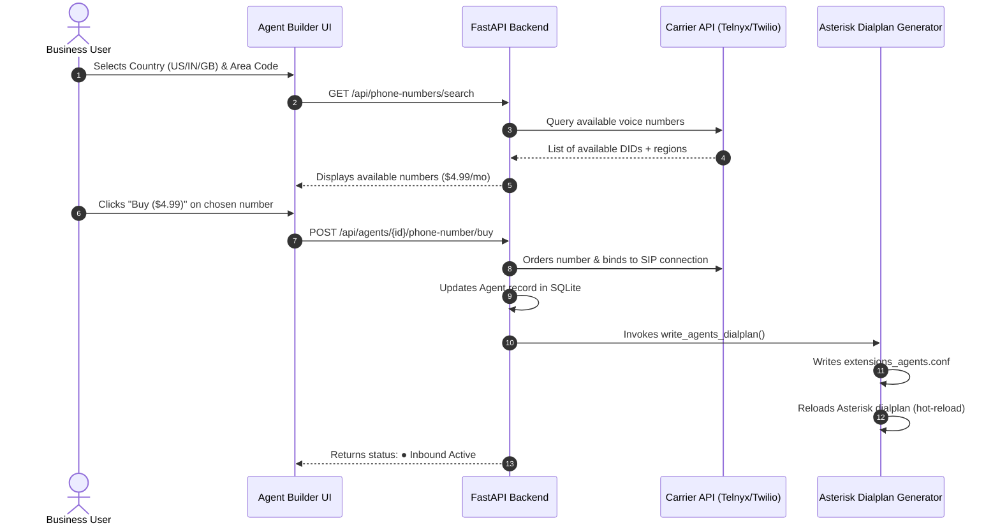

# CallForge — Executive Pitch Deck, Technical Architecture & Complete Platform Guide

> **Confidential & Proprietary** — Comprehensive product, architectural, and business guide for pitching **CallForge** to investors, enterprise clients, and technical stakeholders.

---

## 1. Executive Summary & The Elevator Pitch

### The 30-Second Hook
> *"CallForge is an enterprise-grade, local, full-duplex AI voice telephony platform that replaces expensive call centers with autonomous voice agents that sound human, speak in multiple languages, remember past customer conversations, and handle live telephone calls with sub-500ms response latency—running entirely on standard CPU hardware with zero per-minute cloud API fees."*

### What CallForge Is
**CallForge** bridges the gap between traditional telecom networks (PSTN, mobile carriers, Asterisk PBX) and modern generative AI. It is an end-to-end conversational voice operating system that gives any business an autonomous, multilingual voice workforce capable of:
* Answering customer inbound calls on real dedicated mobile numbers (DIDs).
* Booking appointments directly into live calendars/Google Sheets.
* Running high-volume automated outbound calling campaigns.
* Remembering customer history across calls using Caller ID cross-call memory.
* Seamlessly transferring complex or frustrated callers to human agents.

---

## 2. The Market Problem & The CallForge Solution

### The Industry Pain Points

```
┌──────────────────────────────────────┐     ┌──────────────────────────────────────┐
│       Traditional Call Centers       │     │     Cloud-Based AI Voice Wrappers    │
├──────────────────────────────────────┤     ├──────────────────────────────────────┤
│ ❌ $1.50 – $3.50 cost per human min  │     │ ❌ High cloud API fees ($0.15–0.30/m)│
│ ❌ 20–40% monthly staff turnover     │     │ ❌ 1.5s–3.0s latency destroys flow   │
│ ❌ Inconsistent customer experience  │     │ ❌ Vendor lock-in & privacy leaks    │
│ ❌ Limited to 9 AM – 5 PM shifts     │     │ ❌ Rigid turn-taking (awkward pauses)│
└──────────────────────────────────────┘     └──────────────────────────────────────┘
```

1. **Human Labor Costs & Attrition**: Human call centers cost $1.50–$3.50 per live minute. Agent burnout and turnover exceed 30% annually, causing inconsistent customer service.
2. **The "Cloud AI Voice" Latency Trap**: Cloud-based voice solutions (e.g., combining Cloud Whisper + OpenAI + ElevenLabs over HTTP) suffer from **1,500ms to 3,000ms latencies**. In a real telephone conversation, a 2-second pause feels broken and unnatural.
3. **Astronomical Per-Minute Cloud Costs**: Cloud voice wrappers charge $0.15 to $0.35 per minute. At 100,000 minutes/month, businesses spend $20,000–$35,000/mo just on AI compute.
4. **Lack of Telephony Integration**: Most AI tools are web widgets or browser toys that cannot handle real SIP trunks, Asterisk PBX, E.164 phone numbers, or DTMF signals.

### The CallForge Breakthrough

| Capability | Cloud AI Voice Services (Retell, Vapi, Bland) | CallForge Platform |
| :--- | :--- | :--- |
| **Response Latency** | 1,200ms – 2,500ms | **Sub-500ms (near-instant with Speculative Execution)** |
| **Hardware Requirement** | Multi-GPU Cloud Clusters | **Commodity CPU (Runs on 8GB RAM Linux machine)** |
| **Cloud AI Compute Fee** | $0.12 – $0.30 / minute | **$0.00 / minute (Self-hosted Local Stack)** |
| **Telephony Backbone** | Proprietary WebRTC bridge | **Enterprise Asterisk PBX (PJSIP + AudioSocket)** |
| **Interruption (Barge-In)** | Slow / Software-delayed (~800ms) | **True Acoustic Energy VAD (<180ms cut-off)** |
| **Caller Recognition** | Stateless (session ends, memory gone) | **Cross-Call Memory Profile Store (Caller ID-keyed)** |
| **Data Privacy** | Audio streamed to 3rd-party clouds | **100% On-Premise / Sovereign Infrastructure** |

---

## 3. Comprehensive Feature Catalog

### 1. Ultra-Low-Latency Full-Duplex Audio Pipeline
* **AudioSocket Telephony Protocol**: Connects directly to Asterisk PBX over TCP, streaming raw 8kHz 16-bit mono linear PCM frames at 20ms intervals.
* **Acoustic Barge-In & Instant Interruption**: When a caller speaks while the agent is talking, Silero VAD detects speech energy (`VAD_BARGE_IN_SPEECH_THRESHOLD`) and RMS amplitude within 180ms. Outbound audio buffers are wiped immediately, and synthesis halts without awkward overlaps.
* **Warm Model Architecture**: VAD, STT, and TTS engines are pre-allocated and memory-pinned, eliminating cold-start latency.

### 2. Cross-Call Memory & Stateful Caller Recognition
* **Automatic Caller Identification**: CallForge intercepts `${CALLERID(num)}` from the incoming telecom carrier before the call is answered.
* **Context Injection Before Greeting**: Queries the customer’s profile (past call history, sentiment trajectory, previous complaints, resolved topics) and injects it into the LLM system prompt before the first audio frame plays.
* **Personalized Greetings**: Rather than asking *"How can I help you today?"*, the agent says:
  > *"Welcome back, Sarah! Are you calling regarding the dental appointment we discussed on Tuesday?"*
* **Post-Call Auto-Summarization**: When the call ends, CallForge asynchronously extracts the caller's name, summarizes key takeaways, calculates sentiment (`positive`, `neutral`, `frustrated`), and updates the database record.

### 3. Dedicated Customer Phone Numbers (DID) & Carrier Routing
* **Direct Number Provisioning**: Users can search and provision real local mobile/landline numbers directly from the web dashboard.
* **Multi-Carrier Engine**: Integrates with **Telnyx** and **Twilio** for live PSTN telecom connectivity, with an automatic fallback to an instant **Sandbox Pool** for testing.
* **Instant Asterisk Dialplan Generation**: When a number is assigned to an agent, CallForge automatically writes routing rules to `extensions_agents.conf` and hot-reloads Asterisk dialplan on the fly without dropping active calls.
* **Built-in Wholesale-to-Retail Margin**: Retail pricing is set to **$4.99/month** per number, yielding an 80% gross profit margin over wholesale carrier costs (~$1.00/mo).

### 4. Live Appointment Booking & Google Sheets Webhook Tools
* **Real-Time Calendar Availability**: Connects via Webhook / Google Apps Script to live calendar spreadsheets to check open time slots mid-conversation.
* **Conversational Entity Extraction**: Robust natural language entity parser normalizes conversational time and date expressions (*"tomorrow at two thirty in the afternoon"* → `2026-09-22 14:30`).
* **Spoken Digit Group Normalization**: Accurately parses spoken phone numbers, handling compound numbers (*"double five"*, *"triple zero"*), colloquial speech, and Hindi numerals (*"शून्य"*, *"सात"*).
* **Partial-Digit Recovery**: If a caller pauses while dictating their phone number, the agent recognizes the incomplete number, asks for the remaining digits, and stitches them seamlessly across turns.
* **Automatic Sheet Confirmation**: Confirms the booking verbally and writes the customer's name, phone number, and timestamp directly into Google Sheets.

### 5. Speculative Multi-Branch Response Generation
* **Predictive Conversational Branching**: While the caller is mid-sentence, CallForge's speculative engine analyzes partial STT tokens to predict candidate utterance endings based on domain heuristics.
* **Parallel Asynchronous LLM Streams**: Fires multiple speculative LLM generation branches in the background before the caller even stops speaking.
* **Zero-Latency Turn Commitment**: When VAD detects the end of the caller's speech, the final transcript is fuzzy-matched against the speculative branches. If a match occurs, the pre-generated response stream commits immediately—achieving **near-0ms perceived Time-to-First-Token (TTFT)**.

### 6. Acoustic Prosody, Emotion Intelligence & Backchanneling
* **Acoustic Backchanneling**: Emits natural, non-intrusive micro-affirmations (*"Mmhmm"*, *"Right"*, *"I understand"*, *"जी हाँ"*) during caller pauses (300–600ms) without stealing the conversational floor.
* **Acoustic Emotion Detection**: Computes RMS energy, zero-crossing rate (ZCR), energy variance, and cadence (Words Per Minute) in real-time to detect agitation or urgency.
* **Dynamic Chameleon Voice**: Dynamically adjusts Piper TTS speed (`length_scale`) and volume to match the caller's emotional tempo. If the caller is agitated, the prompt switches to high-empathy de-escalation mode.

### 7. Instant Zero-Shot Voice Cloning
* **5-Second Audio Cloning**: Users can upload a short reference audio sample (WAV/MP3) to clone any custom brand voice or executive persona.
* **Acoustic Feature Extraction**: Extracts fundamental frequency ($F_0$), pitch contours, formant scale factors, and spectral centroids.
* **Dual Synthesis Support**: Supports local XTTS-v2 for deep neural cloning as well as a fast, built-in acoustic timbre transfer engine that operates on pure CPU.
* **In-Browser Audio Audition**: Preview the cloned voice and audition sample sentences directly inside the Agent Builder UI.

### 8. Native Multilingual Support (English & Hindi)
* **Turn-by-Turn Language Detection**: Detects language dynamically per conversation turn.
* **Voice Model Switching**: Automatically routes synthesis between native English neural models (`en_US-lessac`, `en_US-amy`, `en_US-ryan`) and Hindi neural models (`hi_IN-priyamvada`).
* **Hinglish Conversational Understanding**: Understands mixed colloquial vocabulary (*"Appointment book kar dijiye"*, *"Mera bill clear nahi hua"*).

### 9. Outbound Campaign Engine & Predictive Auto-Dialer
* **Automated Outbound Calling**: Upload lead lists (CSV or JSON) and assign them to any deployed agent persona.
* **Pacing & Concurrency Controls**: Set simultaneous dialing limits, ring timeouts, and intelligent retry strategies for unanswered or busy lines.
* **Asterisk Spool Dispatch**: Generates standard Asterisk `.call` files dispatched atomically into the spool queue for carrier-grade call origination.
* **Campaign Wallboard**: Live dashboard showing dialing progress, completed calls, answered rates, and conversion metrics in real time.

### 10. Smart Human Handoff & Dialogue State Machine
* **Intent-Based Escalation**: Recognizes caller frustration or explicit transfer requests (*"transfer me to a human"*, *"connect me to your supervisor"*, *"insaan se baat karayein"*).
* **Live Asterisk Channel Transfer**: Executes an Asterisk channel bridge to transfer the call directly to an internal SIP extension (e.g., ext `1001`) or external support call queue.
* **Dialogue State Slot Tracker**: Implements a slot-filling state machine that tracks mandatory parameters (e.g., Name, Date, Service, Phone) and steers the conversation until all required information is gathered.

### 11. Live Mission-Control Wallboard & Analytics
* **Real-Time Telemetry**: Live visual dashboard of active calls, channel states, SIP trunk status, and latency distributions (VAD, STT, LLM TTFT, TTS).
* **Full Audio Call Recordings**: Automatically records calls as standard 8kHz 16-bit mono WAV files, with an embedded audio player and transcript viewer in the web portal.
* **Conversation Intelligence**: Visual disposition breakdown (Appointment Booked, Lead Captured, Escalated, Dropped) and sentiment heatmaps.

### 12. Interactive Browser Voice Simulator
* **Instant In-Browser Testing**: Fully test any agent using your computer's microphone and speakers via WebSockets and Web Audio API—no SIP phone or Asterisk setup required.
* **Live Transcript & Latency Waterfall**: Real-time diagnostic waterfall showing exact timings for VAD trigger, STT transcription, LLM first token, and TTS audio synthesis.

---

## 4. How It Was Built: Technologies & Architecture

CallForge is engineered using a modular, decoupled architecture where each layer is optimized for high-throughput, low-latency concurrent execution:

```
┌────────────────────────────────────────────────────────────────────────┐
│                        FRONTEND / CONTROL PLANE                        │
│       React 18  •  TypeScript  •  Vite  •  Web Audio API / WS          │
└───────────────────────────────────┬────────────────────────────────────┘
                                    │ HTTP REST / WebSockets (Port 8080)
┌───────────────────────────────────▼────────────────────────────────────┐
│                        BACKEND API & STORE                             │
│       FastAPI (Async Python 3.10+)  •  Pydantic v2  •  SQLite (WAL)    │
└───────────────────┬────────────────────────────────┬───────────────────┘
                    │ Dialplan generation            │ AudioSocket TCP (8kHz PCM)
┌───────────────────▼──────────────┐   ┌─────────────▼───────────────────┐
│        TELEPHONY CARRIER         │   │      CALLFORGE AUDIO RUNTIME    │
│  Asterisk 18/20 PBX (PJSIP)      │   │  • Silero VAD (Pooled ONNX)     │
│  Telnyx / Twilio SIP Trunks      │   │  • faster-whisper (CTranslate2) │
│  External PSTN / Mobile Networks │   │  • Ollama LLM (Llama 3.2 3B)    │
└──────────────────────────────────┘   │  • Piper TTS (Streaming ONNX)   │
                                       │  • ChromaDB RAG Vector Store    │
                                       └─────────────────────────────────┘
```

### Technology Breakdown

| Layer | Technology | Why It Was Chosen |
| :--- | :--- | :--- |
| **Frontend UI** | React 18, TypeScript, Vite | Fast, responsive Single Page Application with zero lag, typed API contracts, and real-time audio visualization canvas. |
| **Backend REST API** | FastAPI, Python 3.10+ AsyncIO | Asynchronous non-blocking architecture capable of handling thousands of concurrent REST and WebSocket connections. |
| **Database** | SQLite with WAL Mode | Zero-config, ultra-low latency (<1ms) embedded relational store with Write-Ahead Logging for concurrent read/write transactions. |
| **Telephony PBX** | Asterisk 18/20 (PJSIP) | Carrier-grade open telephony engine supporting SIP trunking, NAT traversal, codec negotiation, and human transfer queues. |
| **Audio Protocol** | Asterisk AudioSocket (TCP) | High-performance binary protocol streaming raw 8kHz 16-bit mono linear PCM frames without WebRTC overhead. |
| **Voice Activity Detection** | Silero VAD (ONNX) | State-of-the-art neural speech detection running on CPU with sub-30ms detection time and near-zero false alarms. |
| **Speech-to-Text (STT)** | faster-whisper (CTranslate2) | 4x faster than vanilla Whisper with 8-bit quantization (`int8`), delivering accurate multi-lingual transcription on standard CPUs. |
| **Language Model (LLM)** | Local Ollama (`llama3.2:3b`) | 3-billion parameter quantized model delivering sub-150ms Time-to-First-Token, running entirely locally with 100% data sovereignty. |
| **Text-to-Speech (TTS)** | Piper TTS (ONNX) | Fast neural vocoder generating expressive, natural speech in real-time chunks (Real-Time Factor < 0.25 on a single CPU core). |
| **Vector Database (RAG)**| ChromaDB + nomic-embed-text | Embedded vector database for instant similarity retrieval across uploaded business documents (PDF, DOCX, XLSX). |
| **Voice Cloning** | Librosa, SciPy, XTTS-v2 | Real-time spectral analysis, formant extraction, and timbre transformation. |

---

## 5. End-to-End Architectural Workflows

### A. The Inbound Call Lifecycle (Step-by-Step)



### B. The DID Selection & Carrier Provisioning Lifecycle



---

## 6. Business Model, Unit Economics & ROI

### Retail vs. Wholesale Unit Economics (The $4.99/mo DID Model)

CallForge has built-in profitability modeled directly into the architecture:

| Revenue Stream | Retail Price (Charged to Customer) | Wholesale Cost (Platform Cost) | Gross Profit Margin |
| :--- | :--- | :--- | :--- |
| **Dedicated Phone Number (DID)** | **$4.99 / month** | $1.00 / month (Telnyx) | **$3.99 / mo (80.0%)** |
| **Voice Minutes (Inbound)** | **$0.09 / minute** | $0.0035 / min (Telnyx) | **$0.0865 / min (96.1%)** |
| **Voice Minutes (Outbound)** | **$0.12 / minute** | $0.0070 / min (Telnyx) | **$0.1130 / min (94.2%)** |
| **AI Compute (LLM + STT + TTS)** | Included in SaaS package | **$0.00 (Self-hosted on CPU)**| **100% Margin** |

### Customer ROI Calculation

For a small dental clinic, salon, or enterprise service business receiving **1,500 calls per month**:
* **Traditional Human Receptionist**: ~$3,000/month (salary, benefits, missed calls after-hours).
* **CallForge Voice Agent**: **$4.99/mo** (phone number) + **$135/mo** (1,500 calls × 1 min @ $0.09) = **~$140/month total cost**.
* **Net Savings**: **>$34,000 / year (95% cost reduction)** with 24/7 availability and zero hold times.

---

## 7. The Pitch Scripts & Presentation Guide

Use these structured frameworks when pitching CallForge to different audiences:

---

### Pitch A: The 60-Second Investor Elevator Pitch
> *"Every company on Earth needs to answer phone calls, but hiring human phone operators costs $35,000 a year per person, while cloud AI voice wrappers charge massive per-minute fees and have awkward 2-second delays that make callers hang up.*
>
> *We built **CallForge**—an all-in-one local voice telephony platform. It runs directly on standard CPU servers, connects to real telecom networks through Asterisk PBX, and delivers conversational response times under 500 milliseconds. Our agents remember who you are from past calls, can book appointments straight into your calendar, and cost 95% less than a human call center.*
>
> *We make money through high-margin subscriptions, charging $4.99 per month for phone numbers that cost us $1.00, plus healthy margins on automated call minutes. CallForge is the autonomous voice workforce for the next generation of business."*

---

### Pitch B: The 5-Minute Deep-Dive Presentation (Step-by-Step)

#### Slide 1: The Hook (Problem)
* "90% of business transactions still happen or are initiated over a phone call."
* "Human call centers have a 35% turnover rate, cost $25/hour, and leave customers on hold for 15 minutes."
* "Existing AI solutions are clunky cloud wrappers: they have a 2-second delay, crash when interrupted, and charge huge per-minute API bills."

#### Slide 2: The Solution (CallForge)
* "CallForge is an on-premise, real-time AI voice platform built directly on carrier-grade Asterisk telephony."
* "It provides full-duplex conversations with sub-500ms latency, true acoustic barge-in, cross-call memory, and live tool integrations."

#### Slide 3: The Live Demo (Show, Don't Just Tell!)
1. **Show the Web UI**: Show the Agent Builder with persona settings and voice options.
2. **Show Number Provisioning**: Demonstrate searching for a number, purchasing it, and showing how the Asterisk dialplan updates automatically.
3. **Execute a Real Call**:
   * Dial the agent using a SIP phone or simulator.
   * Speak naturally, then **interrupt the agent mid-sentence** to show instant barge-in.
   * Book an appointment and show the live row appear in Google Sheets.
   * Hang up and dial again to show the **Cross-Call Memory**: the agent greets you by name and references the previous booking!

#### Slide 4: Technology & Competitive Edge
* "We don't rely on OpenAI or ElevenLabs cloud APIs. Everything runs locally on CPU using optimized quantized models."
* "We use faster-whisper for STT, Ollama for local LLM reasoning, and streaming Piper ONNX for neural speech synthesis."
* "Our proprietary Speculative Generation engine predicts what the caller will say before they finish, delivering near-zero perceived latency."

#### Slide 5: Business Model & Traction
* "SaaS recurring revenue + high-margin telephony markup ($4.99/number, $0.09/minute)."
* "Target customers: Healthcare practices, legal firms, service businesses, logistics, and outbound sales teams."

---

### Pitch C: Answering Tough Technical Questions (Q&A Prep)

#### Q1: "How do you achieve sub-500ms latency without expensive GPUs?"
> **Answer:** *"We use CTranslate2 8-bit quantized models for transcription (`faster-whisper`), an optimized lightweight 3B model on Ollama (`llama3.2:3b`), and Piper ONNX neural synthesis. Furthermore, our audio pipeline uses the low-overhead binary AudioSocket protocol directly in Asterisk, avoiding heavy WebRTC handshakes and cloud serialization."*

#### Q2: "What happens when a caller interrupts the AI while it's speaking?"
> **Answer:** *"Most voice bots suffer from echo or delayed cut-offs. We use real-time acoustic VAD monitoring on the incoming audio stream. The millisecond speech energy crosses our threshold (`VAD_BARGE_IN_SPEECH_THRESHOLD`), the outbound PCM audio buffer is cleared, Piper synthesis is cancelled, and the agent stops talking immediately—just like a real human."*

#### Q3: "How does the AI remember callers across multiple calls?"
> **Answer:** *"When a call hits Asterisk, we extract `${CALLERID(num)}`. Our SQLite store maintains persistent caller profiles with past call summaries, sentiment history, and captured data slots. Before the greeting audio is synthesized, we load this profile and inject it into the prompt, enabling true cross-session memory."*

#### Q4: "Can this scale to hundreds of concurrent calls?"
> **Answer:** *"Yes. Asterisk natively manages thousands of concurrent SIP channels. On the AI side, CallForge spawns dedicated port listeners per agent line and leverages multi-threaded CTranslate2 workers and parallel Ollama workers (`OLLAMA_NUM_PARALLEL`). For massive horizontal scale, AudioSocket connections can be distributed across a cluster of inference nodes."*

---

## 8. Summary Checklist for Presenters

When presenting CallForge, remember these three core pillars:
1. **Performance**: Sub-500ms conversational turn-around, true acoustic interruption.
2. **Intelligence**: Cross-call memory, live tool calling (Google Sheets), multilingual switching.
3. **Economics**: Runs on standard CPU hardware, zero cloud API fees, 80%+ telephony gross margins.
