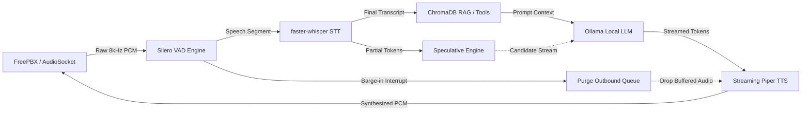
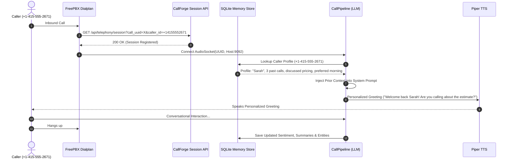

# CallForge — Real-Time AI Calling Agents & Telephony Platform

[](LICENSE)
[](https://python.org)
[](https://fastapi.tiangolo.com)
[](https://react.dev)
[](docs/FREEPBX_AUDIOSOCKET.md)
[-purple.svg)](#)

**CallForge** is an enterprise-grade, sovereign, full-duplex conversational AI voice telephony platform designed for **FreePBX and Asterisk**. It connects using **Method 1: Direct AudioSocket** (raw 8kHz 16-bit PCM streaming over TCP) rather than a SIP trunk — achieving ultra-low audio latency (<5ms transmission), instant sub-180ms acoustic barge-in, and zero cloud API dependency.

The conversational runtime integrates **Silero VAD → faster-whisper (CTranslate2) STT → Speculative RAG & Dynamic Tools → Local Ollama LLM → Streaming Piper TTS (ONNX)**, wrapped in a modern React control plane.

> 📖 **Primary FreePBX Guide:** [docs/FREEPBX_AUDIOSOCKET.md](docs/FREEPBX_AUDIOSOCKET.md) — How FreePBX manages trunks and phones while CallForge acts as the neural voice engine.  
> 📊 **Executive Overview & Pitch:** [PROJECT_OVERVIEW_AND_PITCH.md](PROJECT_OVERVIEW_AND_PITCH.md)  
> 📑 **Master Presentation & Architecture Walkthrough:** [PRESENTATION_AND_PROJECT_GUIDE.md](PRESENTATION_AND_PROJECT_GUIDE.md)

---

## Table of Contents

- [Why Method 1: Direct AudioSocket?](#why-method-1-direct-audiosocket)
- [System Architecture](#system-architecture)
  - [FreePBX Telephony & AudioSocket Flow](#freepbx-telephony--audiosocket-flow)
  - [Full-Duplex Audio Pipeline](#full-duplex-audio-pipeline)
  - [Cross-Call Memory & Recognition Flow](#cross-call-memory--recognition-flow)
- [Key Capabilities & Subsystems](#key-capabilities--subsystems)
  - [1. Real-Time Conversational Voice Pipeline](#1-real-time-conversational-voice-pipeline)
  - [2. FreePBX Method 1 & Embedded PBX Management](#2-freepbx-method-1--embedded-pbx-management)
  - [3. Cross-Call Memory & Stateful Caller Recognition](#3-cross-call-memory--stateful-caller-recognition)
  - [4. Agent Studio & Multi-Agent Runtime](#4-agent-studio--multi-agent-runtime)
  - [5. Speculative Multi-Branch Response Generation (Near-0ms TTFT)](#5-speculative-multi-branch-response-generation-near-0ms-ttft)
  - [6. Dynamic Tool Execution & Google Sheets Webhooks](#6-dynamic-tool-execution--google-sheets-webhooks)
  - [7. Carrier DID Phone Number Purchasing & Provisioning](#7-carrier-did-phone-number-purchasing--provisioning)
  - [8. Outbound Campaign Engine & Predictive Auto-Dialer](#8-outbound-campaign-engine--predictive-auto-dialer)
  - [9. Zero-Shot Voice Cloning & Timbre Transfer](#9-zero-shot-voice-cloning--timbre-transfer)
  - [10. Document RAG (Retrieval-Augmented Generation)](#10-document-rag-retrieval-augmented-generation)
  - [11. Prosody Tracking, Emotion Intelligence & Backchanneling](#11-prosody-tracking-emotion-intelligence--backchanneling)
  - [12. Multilingual Voice Routing (English & Hindi)](#12-multilingual-voice-routing-english--hindi)
  - [13. Smart Human Handoff & Dialogue Policies](#13-smart-human-handoff--dialogue-policies)
  - [14. Live Wallboard, Analytics & Call WAV Recordings](#14-live-wallboard-analytics--call-wav-recordings)
  - [15. Interactive Web Voice Simulator & Control Plane](#15-interactive-web-voice-simulator--control-plane)
- [Quick Start & Deployment](#quick-start--deployment)
  - [1. Prerequisites](#1-prerequisites)
  - [2. Local Development Setup](#2-local-development-setup)
  - [3. Ollama Setup & Concurrency Tuning](#3-ollama-setup--concurrency-tuning)
  - [4. Running CallForge via Docker](#4-running-callforge-via-docker)
  - [5. FreePBX Method 1 Setup Guide](#5-freepbx-method-1-setup-guide)
  - [6. Testing Agents](#6-testing-agents)
- [Project Structure](#project-structure)
- [API Reference](#api-reference)
  - [Authentication (`/api/auth`)](#authentication-apiauth)
  - [Agents & Personas (`/api/agents`)](#agents--personas-apiagents)
  - [FreePBX & Telephony Server (`/api/telephony`)](#freepbx--telephony-server-apitelephony)
  - [Calls & Audio Recordings (`/api/calls`)](#calls--audio-recordings-apicalls)
  - [Cross-Call Memory (`/api/callers`)](#cross-call-memory-apicallers)
  - [Outbound Campaigns (`/api/campaigns`)](#outbound-campaigns-apicampaigns)
  - [Knowledge Base RAG (`/api/agents/{id}/documents`)](#knowledge-base-rag-apiagentsiddocuments)
  - [Phone Numbers & Carrier DIDs (`/api/phone-numbers`)](#phone-numbers--carrier-dids-apiphone-numbers)
  - [Live Wallboard (`/api/wallboard`)](#live-wallboard-apiwallboard)
  - [Web Voice Simulator (`/api/agents/{id}/simulator`)](#web-voice-simulator-apiagentsidsimulator)
  - [System Health & Utilities (`/api`)](#system-health--utilities-api)
- [Configuration Reference](#configuration-reference)
- [License](#license)

---

## Why Method 1: Direct AudioSocket?

Most AI voice implementations force Asterisk/FreePBX to communicate with the AI engine via a secondary SIP trunk (Method 2). For real-time conversational agents, this introduces severe penalties:

| Feature | Method 1: Direct AudioSocket (CallForge) | Method 2: SIP / PJSIP Trunk |
|---|---|---|
| **Audio Latency** | **Ultra-low (<5ms)** — raw 8kHz PCM streaming directly over TCP | **High (+50–120ms)** — SIP signaling, SDP negotiation & RTP jitter buffering |
| **Barge-In / Interruption** | **Instant (sub-180ms)** — wipes the 20ms frame queue the moment caller speaks | **Sluggish (0.5–1.5s delay)** — buffered RTP frames continue playing in Asterisk buffers |
| **Network Architecture** | **Single hop**: FreePBX channel → CallForge Python AI process | **Double PBX hop**: FreePBX Asterisk → SIP trunk → Local Asterisk → AI process |
| **Firewall / NAT** | **1 single TCP port** per deployed agent (`9092+`) + API port `8080` | **Port explosion**: UDP 5060 + wide RTP UDP ranges (10000–20000) |
| **PBX Ownership** | **FreePBX owns phones & trunks**; CallForge is simply an AI audio endpoint | Complex trunk credentials, outbound routing, and duplicate codec translation |
| **Human Escalation** | **Clean native handoff**: AudioSocket closes and FreePBX routes channel to human | Complex SIP re-invites, REFER transfers, or bridged trunk hairpins |

---

## System Architecture

### FreePBX Telephony & AudioSocket Flow

```
                      ┌────────────────────────────────────────┐
                      │    FreePBX 16/17 (External or Docker)  │
                      │  PSTN Trunks / Softphones / IP Phones  │
                      └───────────────────┬────────────────────┘
                                          │
                     1. Dialplan executes: Answer() + Set(CALL_UUID=${UUID()})
                     2. HTTP GET /api/telephony/session (Registers CALLERID(num))
                                          │
                                          ▼
                      ┌────────────────────────────────────────┐
                      │    Direct TCP AudioSocket (Port 9092+) │
                      │       Bidirectional 8kHz PCM @ 20ms    │
                      └───────────────────┬────────────────────┘
                                          │
                                          ▼
┌────────────────────────────────────────────────────────────────────────────────────────┐
│                              CallForge Runtime Pipeline                                │
│                                                                                        │
│   ┌──────────────┐     ┌──────────────┐     ┌──────────────┐     ┌─────────────────┐   │
│   │  Silero VAD  │ ──► │faster-whisper│ ──► │  Speculative │ ──► │ Local Ollama    │   │
│   │ (8kHz Frame) │     │ (CTranslate2)│     │  RAG & Tools │     │ (Llama 3.2 3B)  │   │
│   └──────────────┘     └──────────────┘     └──────────────┘     └────────┬────────┘   │
│          ▲                                                                │            │
│          │ Instant Barge-in Queue Purge                                   ▼            │
│          └─────────────────────────────────────────────────────── ┌─────────────────┐  │
│                                                                   │ Streaming Piper │  │
│                                                                   │ TTS (8kHz PCM)  │  │
│                                                                   └─────────────────┘  │
└─────────────────────────────────────────┬──────────────────────────────────────────────┘
                                          │
                         3. On call finish or human escalation:
                            AudioSocket terminates
                         4. FreePBX calls: Set(TARGET=${CURL(/api/telephony/handoff/...)})
                         5. FreePBX routes live channel: Goto(from-internal,${TARGET},1)
                                          │
                                          ▼
                      ┌────────────────────────────────────────┐
                      │   Human Agent / Queue / Ring Group     │
                      └────────────────────────────────────────┘
```

### Full-Duplex Audio Pipeline



### Cross-Call Memory & Recognition Flow



---

## Key Capabilities & Subsystems

### 1. Real-Time Conversational Voice Pipeline
- **Method 1 Direct AudioSocket**: FreePBX streams raw 8kHz 16-bit mono PCM over an independent TCP port per agent (`9092+`). No SIP trunk or SIP signaling stack in the AI path.
- **Sub-Second Conversational Latency**: Optimized inference on standard CPU servers (Ryzen 5 / Intel i5 or equivalent) provides turn-around times under 500–800ms without cloud API fees.
- **Sub-180ms Instant Barge-In**: Silero VAD monitors inbound frames during agent speech. The instant caller speech is detected, CallForge cancels the in-flight LLM stream, kills active Piper synthesis, and purges all buffered outbound audio frames (`outbound_queue`), delivering zero-lag interruptions.
- **Asterisk Activity Timer Safeguard**: Sends an immediate silence frame (`b"\x00" * 320`) upon socket connection so Asterisk's 2000ms inactivity timer never drops the channel before speech commences.

### 2. FreePBX Method 1 & Embedded PBX Management
- **Centralized FreePBX Telephony Console**: The web portal provides a dedicated **FreePBX / AudioSocket** view with copy-paste dialplans, live line health, and one-click dialplan reload.
- **Direct Dialing from Internal Extensions**: Dynamically injects `[from-internal-custom]` contexts so physical desk phones or softphones (Zoiper, MicroSIP, Linphone) can dial agent extensions (`2000`, `2001`, `7001`) directly.
- **Embedded FreePBX Docker Stack**: Includes an optional containerized FreePBX stack (`tiredofit/freepbx` + MariaDB) enabled via `docker compose --profile embedded-freepbx up -d`.
- **IP Protection Mode**: The FreePBX Web Admin GUI is bound to `127.0.0.1:8088/admin`, preventing unauthorized external IP access while allowing authorized operators to launch the console from CallForge.

### 3. Cross-Call Memory & Stateful Caller Recognition
- **Persistent Phone Identity**: Callers are indexed by `${CALLERID(num)}` (or simulator ID), tracking lifetime call count, last contact timestamp, sentiment trajectory, and structured outcome dispositions.
- **Context Injection Before Greeting**: Injects historical context (*"Caller called 2 days ago regarding root canal, preferred morning slots, expressed pricing frustration"*) into the LLM system prompt prior to the first utterance.
- **Personalized Recognition Openings**: Returning callers are welcomed naturally by name (*"Welcome back, Sarah! Are you calling to check on the estimate we discussed yesterday?"* / *"नमस्ते राहुल जी! फिर से संपर्क करने के लिए धन्यवाद..."*).
- **Rapport & De-escalation Memory**: If a caller experienced frustration in past calls, the persona automatically adopts an empathetic, reassuring tone.

### 4. Agent Studio & Multi-Agent Runtime
- **Visual Persona Designer**: Configure agent instructions, greeting text, speaking speed (`length_scale`), pitch shift multiplier, and voice models.
- **Multi-Agent Line Isolation**: Deploy multiple independent agents simultaneously on dedicated AudioSocket TCP ports (`9092`, `9093`, `9094`, ...), each bound to unique FreePBX extensions.
- **Hot Deployment & Live Reload**: Deploy, stop, or reconfigure agents from the web console without restarting Asterisk or dropping active calls.
- **A/B Testing Engine**: Deploy side-by-side prompt, voice, or model variants (Variant A vs. Variant B) with configurable traffic-split ratios and live conversion tracking.

### 5. Speculative Multi-Branch Response Generation (Near-0ms TTFT)
- **Predictive Branching During Speech**: Analyzes partial speech recognition tokens while the caller is speaking to forecast 2–3 high-probability utterance completions using semantic, intent, and domain heuristics.
- **Parallel Background LLM Streams**: Spawns asynchronous LLM generation streams for candidate branches before caller turn completion.
- **Zero-Latency Turn Commitment**: When VAD detects turn closure, the final transcript is fuzzy-matched against candidate streams. If matched, the pre-generated response commits immediately, achieving **near-0ms perceived TTFT (Time-To-First-Token)**. Unmatched candidate streams are cancelled automatically.

### 6. Dynamic Tool Execution & Google Sheets Webhooks
- **Real-Time Calendar Availability**: Connects directly to Google Apps Script or REST webhooks to query live appointment dates and open time slots mid-call.
- **Spoken Entity Normalization**: Translates conversational time expressions (e.g., *"ten in the morning"*, *"two thirty pm"* → `10:00 AM`, `02:30 PM`) and verifies against open slots.
- **Spoken Digit Normalization**: Robust parser transforms spoken digit sequences, digit groups (*"double nine"*, *"triple zero"*), and Hindi number words (*"शून्य"*, *"पांच"*) into standardized E.164 phone formats.
- **Partial-Digit Recovery**: Detects incomplete phone numbers caused by caller pauses or VAD cut-offs, prompts the caller for remaining digits, and stitches them seamlessly across turns.
- **Direct Sheet Confirmation**: Automatically writes confirmed reservations with client name, phone number, timestamp, and notes back to the spreadsheet.

### 7. Carrier DID Phone Number Purchasing & Provisioning
- **Live Carrier Inventory Search**: Search live phone numbers across multiple countries (US, GB, IN, CA, etc.) and specific area codes via Telnyx or Twilio.
- **Built-In Sandbox Mode**: Automatically falls back to a simulated demo pool when live carrier keys are not configured, enabling risk-free local testing without credit cards.
- **Automated Dialplan Binding**: Purchasing a number dynamically generates Asterisk routing rules in `extensions_agents.conf` and hot-reloads Asterisk (`asterisk -rx "dialplan reload"`).
- **Sub-500ms Inbound Answering**: Inbound calls hitting the assigned number from any PSTN network bridge via AudioSocket directly to the agent's dedicated Python runtime port.
- **Profitable Unit Economics**: Built-in retail subscription pricing ($4.99/mo) provides an 80% gross profit margin over wholesale carrier costs (~$1.00/mo).

### 8. Outbound Campaign Engine & Predictive Auto-Dialer
- **Automated Dialing Campaigns**: Launch automated outbound campaigns linked to any deployed agent persona.
- **Lead List Management**: Import lead contact lists via CSV or JSON with custom metadata and variable substitution.
- **Pacing, Concurrency & Retry Controls**: Configure dial concurrency, call timeouts, retry intervals, and maximum retry attempts for busy or unanswered leads.
- **Campaign Wallboard & Export**: Live progress tracking of pending, dialing, completed, and failed leads with real-time conversion metrics and CSV export.

### 9. Zero-Shot Voice Cloning & Timbre Transfer
- **One-Click Audio Cloning**: Upload a 5–15 second reference audio sample (WAV, MP3, OGG, FLAC) to clone custom vocal timbre, pitch, and resonance.
- **Acoustic Profiling Engine**: Extracts fundamental frequency ($F_0$ via normalized autocorrelation), formant scale factors, and spectral centroids.
- **Dual Synthesis Architecture**: Integrates with local XTTS-v2 when available, alongside a built-in zero-dependency high-fidelity acoustic timbre transfer engine that runs out of the box.
- **In-Browser Audio Preview**: Audition uploaded reference samples and preview synthesized test phrases directly in the web UI.

### 10. Document RAG (Retrieval-Augmented Generation)
- **Multi-Format Document Ingestion**: Upload PDF, DOCX, XLSX, TXT, and Markdown files into per-agent isolated ChromaDB vector stores.
- **Speculative Retrieval**: Initiates vector similarity search during partial STT to make relevant context available before the LLM prompt is finalized.
- **Grounded Responses**: Restricts answers to uploaded documentation with automatic citation and fallback handling.

### 11. Prosody Tracking, Emotion Intelligence & Backchanneling
- **Acoustic Backchanneling**: Emits natural, non-intrusive vocal acknowledgments (*"Mmhmm"*, *"Right"*, *"I see"*, *"हाँ"*, *"जी"*) during caller breathing micro-pauses (300–600ms) without taking the conversational floor.
- **Acoustic Emotion Detection**: Analyzes audio frame RMS energy, energy variance, zero-crossing rate (ZCR), and speaking cadence (WPM) to classify caller state: `agitated`, `calm`, `fast`, or `neutral`.
- **Dynamic Chameleon Voice**: Dynamically scales Piper TTS pacing (`length_scale`), warmth (`noise_scale`), and volume to match caller prosody.
- **Empathetic LLM Steering**: Injects dynamic prompt directives to de-escalate frustrated callers before generating responses.

### 12. Multilingual Voice Routing (English & Hindi)
- **Automatic Language Detection**: Detects caller language per turn with confidence-based fallback.
- **Dynamic Piper Voice Routing**: Seamlessly switches synthesis between English models (`en_US-ryan-medium`, `en_US-kristin-medium`, `en_US-amy-medium`, `en_US-lessac-medium`) and Hindi models (`hi_IN-priyamvada-medium`).

### 13. Smart Human Handoff & Dialogue Policies
- **Intent-Based Handoff**: Detects escalation phrases (*"talk to a human"*, *"connect to an agent"*, *"insaan se baat karayein"*) with boundary checks to prevent false triggers.
- **Asterisk Channel Transfer**: Seamlessly bridges or transfers callers to human agent queues or extensions (e.g. extension `1001`) via FreePBX dialplan and Asterisk AMI/ARI.
- **Slot-Filling State Machine**: Tracks structured slots (name, date, time, phone number, issue description) across turns until requirements are satisfied.

### 14. Live Wallboard, Analytics & Call WAV Recordings
- **Mission Control Wallboard**: Live dashboard displaying active calls, channel states, line occupancy, SIP trunk status, and latency distributions.
- **Conversation Intelligence**: Automatic post-call sentiment analysis (`positive`, `neutral`, `frustrated`) and disposition tagging (`Appointment Booked`, `Lead Captured`, `Escalated to Human`, `Information Provided`, `Dropped / Hangup`).
- **Session Audio Recordings**: Automatically archives 8kHz 16-bit mono WAV recordings per session, playable directly from the call history view.

### 15. Interactive Web Voice Simulator & Control Plane
- **Browser-Based Microphone Testing**: Test agents directly inside the browser using WebSockets and Web Audio API—no softphone or Asterisk setup needed.
- **Live Latency & Transcript Waterfall**: Inspect live STT transcripts, pipeline latency breakdowns (STT, LLM TTFT, TTS), speculative match status, and tool execution events in real time.
- **Award-Level Frontend**: Built with React 19, Tailwind CSS v4, GSAP, and Lenis smooth scrolling, featuring an interactive ROI calculator, live audio waveform, and multi-tenant authentication.

---

## Quick Start & Deployment

### 1. Prerequisites

- **Host OS**: Linux (Ubuntu 20.04+ recommended; x86_64)
- **Docker & Docker Compose v2** (recommended for production)
- **Python 3.10+ & Node.js 18+** (for bare-metal development)
- **Ollama**: Local LLM server running `llama3.2:3b-instruct-q4_K_M` and `nomic-embed-text`
- **Telephony**: FreePBX 16/17 (Asterisk 18+) with `res_audiosocket` module (either your existing PBX or the embedded Docker container)

---

### 2. Local Development Setup

```bash
# 1. Clone repository
git clone https://github.com/yourusername/calling_agent.git
cd calling_agent

# 2. Set up Python virtual environment
python3 -m venv .venv
source .venv/bin/activate
pip install --upgrade pip
pip install -r requirements.txt

# 3. Build Web Control Plane
cd web
npm install
npm run build
cd ..

# 4. Configure environment
cp env.example .env
```

---

### 3. Ollama Setup & Concurrency Tuning

Pull the required models:
```bash
ollama pull llama3.2:3b-instruct-q4_K_M
ollama pull nomic-embed-text
```

#### Enable Multi-Caller Concurrency:
By default, Ollama processes requests sequentially (`OLLAMA_NUM_PARALLEL=1`). To support concurrent callers:
```bash
sudo systemctl edit ollama.service
```
Add:
```ini
[Service]
Environment="OLLAMA_NUM_PARALLEL=4"
```
Restart Ollama:
```bash
sudo systemctl restart ollama
```

---

### 4. Running CallForge via Docker

#### Option A: External FreePBX (Recommended Production Path)
Use this if FreePBX is running on a dedicated server/VM:

```bash
cp env.example .env

# Edit .env and set your CallForge LAN IP reachable by FreePBX:
# FREEPBX_AUDIOSOCKET_HOST=10.17.2.139
# FREEPBX_API_BASE=http://10.17.2.139:8080

docker compose up -d
```

#### Option B: Embedded FreePBX Stack (All-in-One Containerized PBX)
Runs CallForge, Ollama, FreePBX 16/17, and MariaDB together:

```bash
docker compose --profile embedded-freepbx up -d
```
- **CallForge Web Console**: `http://localhost:8080`
- **FreePBX Admin GUI**: `http://127.0.0.1:8088/admin` (locked to localhost for security)
- **SIP / PJSIP Ports**: UDP `5060`, `5160`
- **RTP Audio Range**: UDP `18000–18100`

---

### 5. FreePBX Method 1 Setup Guide

1. **Deploy your Agent**: Open `http://localhost:8080/agents` and deploy an agent (e.g., Default Agent on port `9092`, extension hint `2000`).
2. **Retrieve Dialplan**: Go to **FreePBX / AudioSocket** in CallForge and click **Copy full dialplan** (or run `curl -s http://<callforge-ip>:8080/api/telephony/freepbx/dialplan`).
3. **Add to FreePBX**:
   Paste the snippet into FreePBX `/etc/asterisk/extensions_custom.conf`:
   ```ini
   ; Allow softphones/desk phones to dial the AI agent directly:
   [from-internal-custom]
   exten => 2000,1,Goto(callforge-agent-2000,s,1)

   [callforge-agent-2000]
   exten => s,1,NoOp(CallForge Method 1 AudioSocket → Default Agent)
    same => n,Answer()
    same => n,Set(CALL_UUID=${UUID()})
    same => n,Set(CF_AGENT_ID=YOUR_AGENT_ID)
    same => n,Set(CF_API=http://YOUR_CALLFORGE_IP:8080)
    same => n,Set(CF_REG=${CURL(${CF_API}/api/telephony/session?call_uuid=${CALL_UUID}&caller_id=${CALLERID(num)}&agent_id=${CF_AGENT_ID})})
    same => n,AudioSocket(${CALL_UUID},YOUR_CALLFORGE_IP:9092)
    same => n,Set(TARGET=${CURL(${CF_API}/api/telephony/handoff/${CALL_UUID})})
    same => n,GotoIf($["${TARGET}" != ""]?do_handoff:do_hangup)
    same => n(do_handoff),Goto(from-internal,${TARGET},1)
    same => n(do_hangup),Hangup()
   ```
4. **Apply Config**: In FreePBX web UI, click **Apply Config** (or run `asterisk -rx "dialplan reload"`).
5. **Route Calls**:
   - For Inbound Trunks: In **Admin → Custom Destinations**, create a target pointing to `callforge-agent-2000,s,1`. Point an Inbound Route or IVR at it.
   - For Internal Phones: Dial `2000` from any softphone (Zoiper, MicroSIP) registered to FreePBX.

---

### 6. Testing Agents

- **In-Browser Simulator (No PBX required)**:
  Open `http://localhost:8080/overview` → Launch **Web Simulator**, select an agent, choose a caller ID, and click **Start Call** to test with your browser microphone.
- **Softphone / Real Call**:
  Dial extension `2000` from your SIP softphone or call the provisioned DID.

---

## Project Structure

```
calling_agent/
├── api/                                # FastAPI REST & WebSocket control plane
│   ├── routes/
│   │   ├── agents.py                   # Agent CRUD, personas, voice assignment & A/B variants
│   │   ├── auth.py                     # User authentication, signup & JWT session tokens
│   │   ├── callers.py                  # Caller profiles & cross-call memory retrieval
│   │   ├── calls.py                    # Call history, transcripts & WAV recordings
│   │   ├── campaigns.py                # Outbound campaigns, CSV lead upload & dialer control
│   │   ├── documents.py                # Per-agent RAG document upload, indexing & vector store
│   │   ├── meta.py                     # System health, telemetry, TTS voice preview & webhook tests
│   │   ├── phone_numbers.py            # Carrier DID search, provisioning & dialplan binding
│   │   ├── simulator.py                # WebSocket in-browser audio simulation endpoint
│   │   ├── telephony_server.py         # FreePBX Method 1 integration, dialplan & PBX status
│   │   └── wallboard.py                # Live wallboard metrics, channel telemetry & call termination
│   ├── schemas.py                      # Pydantic request & response models
│   └── __init__.py                     # FastAPI app factory, CORS, static SPA hosting
├── asterisk-server/                    # Optional legacy Asterisk configuration files
├── callforge/                          # Core CallForge business logic & data persistence
│   ├── ingest/
│   │   └── documents.py                # Parsers for PDF, DOCX, XLSX, TXT, MD
│   ├── runtime/
│   │   ├── agent_runtime.py            # Multi-agent AudioSocket TCP port listener manager
│   │   ├── asterisk_manager.py         # Asterisk AMI/ARI channel management & transfer
│   │   ├── call_session_registry.py    # Cross-host caller ID and handoff session registry
│   │   ├── campaign_engine.py          # Outbound campaign dialer, concurrency & retries
│   │   ├── dialogue.py                 # Slot-filling state machine & prompt directives
│   │   ├── dialplan.py                 # Legacy Asterisk dialplan generator
│   │   ├── freepbx_dialplan.py         # FreePBX Method 1 extensions_custom.conf generator
│   │   ├── telephony_server.py         # PBX presence, PJSIP rendering & intercom calls
│   │   ├── tools.py                    # Google Sheets tools, slot booking & digit parser
│   │   └── voices.py                   # Piper voice path resolution & catalog metadata
│   └── store/
│       ├── db.py                       # SQLite database repository layer
│       └── models.py                   # Dataclasses (Agent, Call, CallerProfile, Campaign, Phone)
├── docs/
│   └── FREEPBX_AUDIOSOCKET.md          # Comprehensive FreePBX Method 1 implementation guide
├── models/
│   └── piper/                          # ONNX voice models and JSON configs
├── platform_data/                      # SQLite DB, WAV recordings, uploads & FreePBX configs
│   └── freepbx/
│       └── extensions_custom_callforge.conf # Auto-generated FreePBX dialplan snippet
├── processing/                         # Real-time DSP and conversational intelligence
│   ├── audio_buffer.py                 # Ring buffers & 20ms frame slicing
│   ├── canned_responses.py             # Pre-synthesized backchannels & acoustic fillers
│   ├── conversational_flow.py          # Turn-taking state machine & pause detection
│   ├── prosody.py                      # RMS, ZCR, speaking rate (WPM) & emotion classifier
│   └── vad.py                          # Silero VAD pooled detector & barge-in logic
├── services/                           # AI model wrappers & telephony providers
│   ├── caller_memory_service.py        # Cross-call caller memory analysis & context injection
│   ├── llm_service.py                  # Ollama streaming client & startup model warm-up
│   ├── rag_service.py                  # ChromaDB vector store & semantic similarity search
│   ├── speculative_service.py          # Speculative multi-branch LLM execution engine
│   ├── stt_service.py                  # faster-whisper CTranslate2 transcription engine
│   ├── telephony_provider.py           # DID carrier provider (Telnyx/Twilio/Sandbox)
│   ├── tts_service.py                  # Streaming Piper TTS & pitch-shift processor
│   └── voice_clone_service.py          # Acoustic profiling & reference audio cloning
├── telephony/                          # AudioSocket protocol implementation
│   ├── protocol.py                     # AudioSocket binary protocol framing & serialization
│   └── server.py                       # Asyncio TCP AudioSocket server & session handler
├── web/                                # React 19 + Vite + Tailwind CSS v4 Control Plane
│   ├── src/
│   │   ├── components/                 # Shell, AuthModal, SimulatorModal
│   │   ├── pages/                      # LandingPage, Dashboard, Agents, Calls, Campaigns, Telephony, Wallboard
│   │   ├── api.ts                      # Frontend API client
│   │   ├── auth.tsx                    # Multi-tenant auth context
│   │   └── toast.tsx                   # Toast notification system
│   ├── index.html                      # HTML template
│   ├── package.json                    # Dependencies (React 19, Lucide, GSAP, Lenis)
│   └── vite.config.ts                  # Vite build configuration
├── config.py                           # Centralized typed Pydantic application settings
├── docker-compose.yml                  # Docker Compose configuration (App + Ollama + FreePBX)
├── docker-entrypoint.sh                # Container initialization & permission fixes
├── Dockerfile                          # Multi-stage CPU-optimized Dockerfile
├── env.example                         # Environment template with documented defaults
├── main.py                             # Process entry point: voice runtime + HTTP control plane
├── pipeline.py                         # Full-duplex conversational audio pipeline state machine
└── requirements.txt                    # Pinned Python package dependencies
```

---

## API Reference

### Authentication (`/api/auth`)
| Method | Endpoint | Description |
|---|---|---|
| `POST` | `/api/auth/signup` | Register a new user account |
| `POST` | `/api/auth/login` | Authenticate and obtain JWT session token |
| `GET` | `/api/auth/me` | Retrieve authenticated user profile |

### Agents & Personas (`/api/agents`)
| Method | Endpoint | Description |
|---|---|---|
| `GET` | `/api/agents` | List all configured agents |
| `POST` | `/api/agents` | Create a new agent persona |
| `GET` | `/api/agents/{agent_id}` | Get agent details, prompts, and voice configuration |
| `PATCH` | `/api/agents/{agent_id}` | Update agent settings, prompt, tools, or voice |
| `DELETE` | `/api/agents/{agent_id}` | Delete an agent |
| `POST` | `/api/agents/{agent_id}/deploy` | Deploy agent on dedicated AudioSocket TCP port |
| `POST` | `/api/agents/{agent_id}/undeploy` | Stop active agent line |
| `GET` | `/api/agents/{agent_id}/ab-stats` | Retrieve A/B testing conversion statistics |
| `POST` | `/api/agents/{agent_id}/voice-clone/upload` | Upload 5–15s reference audio sample for cloning |
| `GET` | `/api/agents/{agent_id}/voice-clone/sample` | Stream reference audio WAV |
| `GET/POST`| `/api/agents/{agent_id}/voice-clone/preview` | Preview synthesized speech using cloned timbre |
| `DELETE` | `/api/agents/{agent_id}/voice-clone` | Remove cloned voice profile |

### FreePBX & Telephony Server (`/api/telephony`)
| Method | Endpoint | Description |
|---|---|---|
| `GET` | `/api/telephony/freepbx` | Get FreePBX Method 1 status, live lines, and dialplan bundle |
| `GET` | `/api/telephony/freepbx/dialplan` | Plain-text `extensions_custom.conf` for copy-pasting |
| `GET` | `/api/telephony/freepbx/agents/{agent_id}` | Structured dialplan and setup guide for an agent |
| `GET` | `/api/telephony/session` | Register call UUID and caller ID via GET query (used by FreePBX `CURL`) |
| `POST` | `/api/telephony/session` | Register call UUID and caller ID via JSON POST |
| `GET` | `/api/telephony/handoff/{call_uuid}` | Returns plain-text target extension for FreePBX `CURL` transfer |
| `GET` | `/api/telephony/freepbx/gui-status` | Check FreePBX Admin Web GUI accessibility and status |
| `GET` | `/api/telephony/server` | Comprehensive telephony overview (FreePBX + legacy PBX) |
| `GET` | `/api/telephony/phones` | List registered SIP phone extensions (legacy/embedded) |
| `POST` | `/api/telephony/phones` | Add an internal SIP extension |
| `PUT` | `/api/telephony/phones/{phone_id}` | Update SIP extension settings |
| `DELETE` | `/api/telephony/phones/{phone_id}` | Delete SIP extension |
| `POST` | `/api/telephony/phones/bulk` | Bulk create extensions |
| `POST` | `/api/telephony/reload` | Reload PJSIP endpoints and dialplan |
| `POST` | `/api/telephony/call` | Originate internal intercom / test call |

### Calls & Audio Recordings (`/api/calls`)
| Method | Endpoint | Description |
|---|---|---|
| `GET` | `/api/calls` | List call sessions with pagination and search |
| `GET` | `/api/calls/{call_id}` | Get full call session details, turn transcripts & latency |
| `GET` | `/api/calls/{call_id}/audio` | Stream or download session 8kHz 16-bit mono WAV recording |

### Cross-Call Memory (`/api/callers`)
| Method | Endpoint | Description |
|---|---|---|
| `GET` | `/api/callers` | List tracked caller profiles, lifetime calls, and sentiment |
| `GET` | `/api/callers/{phone_number}` | Get full profile, past call summaries, and extracted entities |
| `DELETE` | `/api/callers/{phone_number}` | Delete caller profile and reset memory |

### Outbound Campaigns (`/api/campaigns`)
| Method | Endpoint | Description |
|---|---|---|
| `GET` | `/api/campaigns` | List all outbound auto-dialing campaigns |
| `POST` | `/api/campaigns` | Create a new campaign |
| `GET` | `/api/campaigns/{campaign_id}` | Get campaign status and progress metrics |
| `PATCH` | `/api/campaigns/{campaign_id}` | Update campaign settings, concurrency, or greeting |
| `DELETE` | `/api/campaigns/{campaign_id}` | Delete a campaign |
| `POST` | `/api/campaigns/{campaign_id}/contacts` | Add contacts to campaign via JSON |
| `POST` | `/api/campaigns/{campaign_id}/contacts/csv` | Import lead contact list via CSV |
| `GET` | `/api/campaigns/{campaign_id}/contacts` | List contacts with call status and retry count |
| `POST` | `/api/campaigns/{campaign_id}/start` | Start or resume outbound dialing |
| `POST` | `/api/campaigns/{campaign_id}/pause` | Pause campaign dialing |
| `POST` | `/api/campaigns/{campaign_id}/reset` | Reset completed/failed contacts to pending |
| `GET` | `/api/campaigns/{campaign_id}/export` | Export campaign results as CSV |

### Knowledge Base RAG (`/api/agents/{id}/documents`)
| Method | Endpoint | Description |
|---|---|---|
| `GET` | `/api/agents/{agent_id}/documents` | List indexed documents for an agent |
| `POST` | `/api/agents/{agent_id}/documents` | Upload and vectorize PDF, DOCX, XLSX, or TXT file |
| `DELETE` | `/api/documents/{doc_id}` | Remove document from ChromaDB vector store |

### Phone Numbers & Carrier DIDs (`/api/phone-numbers`)
| Method | Endpoint | Description |
|---|---|---|
| `GET` | `/api/phone-numbers/pricing` | View retail pricing and currency info |
| `GET` | `/api/phone-numbers/search` | Search available DID numbers by country and area code |
| `POST` | `/api/agents/{agent_id}/phone-number/buy` | Purchase and bind a DID number to an agent |
| `DELETE` | `/api/agents/{agent_id}/phone-number` | Release provisioned DID number |

### Live Wallboard (`/api/wallboard`)
| Method | Endpoint | Description |
|---|---|---|
| `GET` | `/api/wallboard/status` | Real-time system telemetry, active lines & channel counts |
| `GET` | `/api/wallboard/live-calls` | Active in-progress calls with live latency waterfall |
| `POST` | `/api/wallboard/calls/{call_uuid}/hangup` | Force terminate an active call channel |

### Web Voice Simulator (`/api/agents/{id}/simulator`)
| Method | Endpoint | Description |
|---|---|---|
| `WS` | `/api/agents/{agent_id}/simulator/ws` | Full-duplex WebSocket audio channel for browser testing |

### System Health & Utilities (`/api`)
| Method | Endpoint | Description |
|---|---|---|
| `GET` | `/api/health` | Comprehensive system health and runtime status |
| `GET` | `/api/stats` | Aggregated fleet call volume and statistics |
| `GET` | `/api/options` | Available models, Piper voices, and suggested extensions |
| `GET` | `/api/voice-sample` | Synthesize and preview a Piper voice sample |
| `POST` | `/api/tools/test-webhook` | Test Google Sheets appointment webhook connectivity |
| `POST` | `/api/telephony/reload-asterisk` | Trigger Asterisk dialplan reload |

---

## Configuration Reference

CallForge reads typed configuration from environment variables or a `.env` file via Pydantic Settings:

| Environment Variable | Default | Subsystem | Description |
|---|---|---|---|
| `LOG_LEVEL` | `INFO` | App | Logging level (`DEBUG`, `INFO`, `WARNING`, `ERROR`) |
| `API_HOST` | `0.0.0.0` | API | Host bind address for FastAPI REST & Web UI |
| `API_PORT` | `8080` | API | Port bind for FastAPI REST & Web UI |
| `TELEPHONY_HOST` | `0.0.0.0` | Telephony | Bind address for AudioSocket TCP server |
| `TELEPHONY_PORT` | `9092` | Telephony | Base port for AudioSocket listener (`9092+` per agent) |
| `TELEPHONY_MAX_CONCURRENT_CALLS` | `2` (or `4` in compose) | Telephony | Max concurrent calls per deployed agent line |
| `TELEPHONY_OUTBOUND_QUEUE_MAX_FRAMES` | `200` | Telephony | Outbound audio buffer capacity (~4s barge-in ceiling) |
| `FREEPBX_AUDIOSOCKET_HOST` | *(empty)* | FreePBX | LAN IP of CallForge host that FreePBX connects to |
| `FREEPBX_API_BASE` | `http://<host>:8080` | FreePBX | Public URL FreePBX uses to register caller ID & handoffs |
| `FREEPBX_WEB_PORT` | `8088` | Embedded PBX | Local port mapped for FreePBX Web Admin GUI |
| `FREEPBX_GUI_URL` | `http://127.0.0.1:8088/admin` | Embedded PBX | Target URL for FreePBX Web GUI |
| `FREEPBX_DB_PASS` | `callforge_asterisk_pass` | Embedded PBX | Database password for FreePBX Asterisk database |
| `VAD_SPEECH_THRESHOLD` | `0.48` | Silero VAD | Speech probability threshold to mark onset |
| `VAD_MIN_SILENCE_MS` | `550` | Silero VAD | Trailing silence to close conversational turn |
| `VAD_PRE_SPEECH_PADDING_MS` | `300` | Silero VAD | Pre-roll audio padding to avoid clipped word onsets |
| `VAD_MIN_SPEECH_MS` | `150` | Silero VAD | Minimum duration to discard acoustic clicks/noise |
| `VAD_TRAILING_SILENCE_KEEP_MS`| `200` | Silero VAD | Trailing silence kept to prevent Whisper hallucinations |
| `VAD_BARGE_IN_SPEECH_THRESHOLD`| `0.48` | Barge-In | Speech threshold to trigger immediate interruption |
| `VAD_BARGE_IN_MIN_SPEECH_MS` | `180` | Barge-In | Consecutive speech duration to confirm barge-in |
| `VAD_BARGE_IN_MIN_RMS` | `75.0` | Barge-In | Minimum RMS amplitude required to trigger barge-in |
| `STT_MODEL_SIZE` | `small` | STT | faster-whisper model (`small`, `base`, `medium`) |
| `STT_DEVICE` | `cpu` | STT | Inference compute device (`cpu`, `cuda`) |
| `STT_COMPUTE_TYPE` | `int8` | STT | CTranslate2 quantization (`int8`, `float16`) |
| `STT_BEAM_SIZE` | `1` | STT | Beam size (1 = greedy search for minimal latency) |
| `STT_NO_SPEECH_PROB_REJECT_THRESHOLD` | `0.6` | STT | Rejection threshold for Whisper non-speech hallucinations |
| `STT_LANGUAGE_PROBABILITY_REJECT_THRESHOLD` | `0.5` | STT | Confidence threshold for language classification |
| `LLM_BASE_URL` | `http://127.0.0.1:11434` | LLM | Local Ollama HTTP API endpoint |
| `LLM_MODEL` | `llama3.2:3b-instruct-q4_K_M` | LLM | Ollama model tag for low-RAM real-time inference |
| `LLM_TEMPERATURE` | `0.6` | LLM | Sampling temperature |
| `LLM_NUM_PREDICT` | `110` | LLM | Max tokens generated per turn (prevents run-on speech) |
| `LLM_KEEP_ALIVE` | `30m` | LLM | Duration to keep LLM warm in memory |
| `LLM_REQUEST_TIMEOUT_S` | `45.0` | LLM | Generation timeout in seconds |
| `TTS_VOICE_MODEL_PATH` | `models/piper/en_US-lessac-medium.onnx` | TTS | Default English Piper ONNX voice model |
| `TTS_VOICE_MODEL_PATH_HI` | `models/piper/hi_IN-priyamvada-medium.onnx` | TTS | Default Hindi Piper ONNX voice model |
| `TTS_LENGTH_SCALE` | `1.12` | TTS | Phoneme length scale (>1 = slower, clearer speech) |
| `TTS_NOISE_SCALE` | `0.5` | TTS | Piper noise scale (lower = cleaner synthesis) |
| `TTS_NOISE_W_SCALE` | `0.7` | TTS | Phoneme-width noise scale |
| `TTS_VOLUME` | `1.05` | TTS | Gain multiplier before 8kHz resampling |
| `TTS_PITCH_SHIFT_FACTOR` | `1.0` | TTS | Pitch shift multiplier (1.0 = normal, 1.15 = lighter) |

---

## License

CallForge is licensed under the [MIT License](LICENSE).
